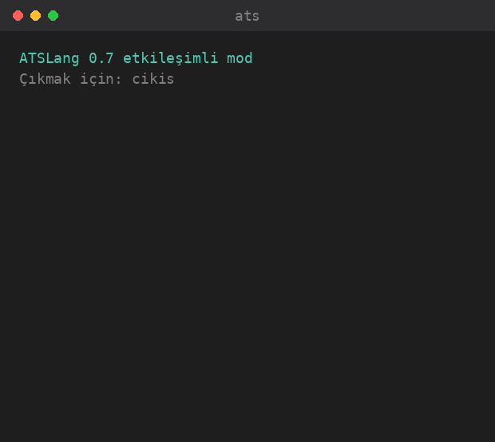
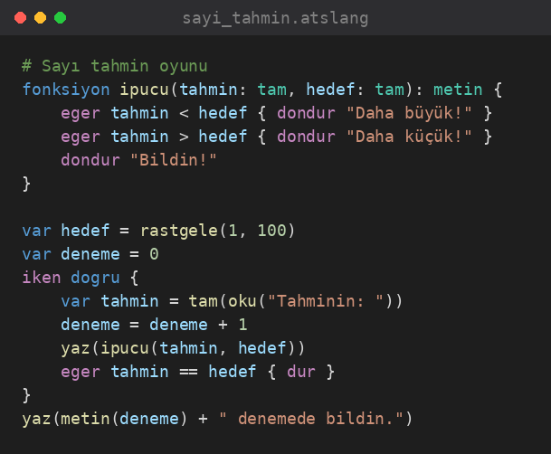
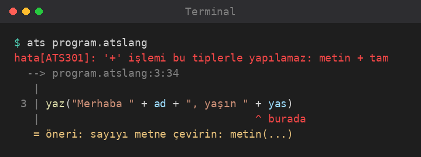

<div align="center">

# 🇹🇷 ATSLang

**Türkçe anahtar kelimeli, öğrenmesi kolay bir programlama dili**

*Python kadar kolay okunan, anlaşılır Türkçe hata mesajları veren bir dil.*

[](docs/spesifikasyon.md)
[](LICENSE)
[](https://www.python.org/)
[](tests)
[](editor/vscode)



</div>

---

## ✨ Neden ATSLang?

- 🗣️ **Türkçe:** `eger`, `degilse`, `iken`, `fonksiyon`, `dondur`... Kod, neredeyse bir cümle gibi okunur.
- 💬 **Anlaşılır hata mesajları:** Hatanın yerini gösterir, nedenini Türkçe açıklar ve çözüm önerir.
- 🔤 **Türkçe karakterlere tam destek:** `buyuk("istanbul")` sonucu `İSTANBUL` olur, `ISTANBUL` değil.
- 🛡️ **Sessiz hata yok:** `"Yaş: " + 5` gibi şüpheli işlemler fark edilmeden geçmez, programcıya bildirilir.
- ⚡ **Hemen dene:** Etkileşimli modda kodu yazıp sonucunu anında görürsün.

## 👀 Hızlı bakış



```python
var meyveler = ["elma", "armut"]
ekle(meyveler, oku("Bir meyve yaz: "))

her meyve meyveler {
    yaz("🍎 " + buyuk(meyve))
}

var kisi = {"ad": "Ali", "yas": 20}
eger kisi["yas"] >= 18 {
    yaz(kisi["ad"] + " reşit")
} degilse {
    yaz(kisi["ad"] + " reşit değil")
}
```

## 💬 Hata mesajları

ATSLang, hatanın nerede olduğunu ve nasıl düzeltileceğini anlatır:



Her hatanın sabit bir kodu (`ATS301` gibi) vardır, bu sayede internette kolayca aranabilir. Mesajlar istenirse İngilizce de gösterilebilir: `ats --dil en`.

## 🧩 Özellikler

| | |
|---|---|
| **Değişkenler** | `var`, `sabit`, isteğe bağlı tipler: `var yas: tam = 20` |
| **Tipler** | `tam`, `ondalik`, `metin`, `mantiksal`, `liste`, `sozluk` |
| **Koşullar** | `eger` / `degilse eger` / `degilse`, `ve`, `veya`, `degil` |
| **Döngüler** | `iken`, `tekrarla 5`, `her i aralik(1, 10)`, `her x liste`, `dur`, `devam` |
| **Fonksiyonlar** | `fonksiyon kare(x: tam): tam { dondur x * x }`, özyineleme |
| **Listeler ve sözlükler** | `[1, 2, 3]`, `{"ad": "Ali"}`, indeksleme, `ekle`, `sil`, `uzunluk` |
| **Standart fonksiyonlar** | `oku`, `yaz`, `bol`, `birlestir`, `buyuk`, `kucuk`, `rastgele`, `karekok` ve daha fazlası |
| **Araçlar** | Etkileşimli mod (REPL), çift tıklayarak çalıştırma, VS Code eklentisi |

## 🚀 Kurulum

**Gereken:** [Python 3.12 veya üstü](https://www.python.org/downloads/)

```bash
git clone https://github.com/DEVEymen/ATSLang.git
cd ATSLang
pip install -e ".[dev]"
```

## ▶️ Kullanım

```bash
ats                                  # etkileşimli mod
ats ornekler/sayi_tahmin.atslang     # bir programı çalıştır
ats --yardim                         # bütün seçenekler
```

**Windows'ta komut yazmadan:**

| Dosya | Ne yapar |
|---|---|
| `kur.bat` | `.atslang` dosyalarını çift tıklayınca çalıştırılabilir yapar (bir kez yapılır) |
| `etkilesimli.bat` | Etkileşimli modu açar |
| `vscode_kur.bat` | VS Code eklentisini kurar |
| `test_et.bat` | Bütün testleri çalıştırır |

## 🎨 VS Code eklentisi

Renkli kod gösterimi, otomatik tamamlama ve kod kalıpları sağlar. `eger` yazıp Enter'a basınca blok kalıbı otomatik gelir.

**Kurulum:** VS Code → Eklentiler (`Ctrl+Shift+X`) → **⋯** → **Install from VSIX...** → `editor/atslang.vsix`

## 📚 Örnekler

| Dosya | İçerik |
|---|---|
| [`merhaba.atslang`](ornekler/merhaba.atslang) | İlk program |
| [`degiskenler.atslang`](ornekler/degiskenler.atslang) | Değişkenler ve matematik |
| [`kosullar.atslang`](ornekler/kosullar.atslang) | `eger` / `degilse` |
| [`donguler_ve_fonksiyonlar.atslang`](ornekler/donguler_ve_fonksiyonlar.atslang) | Asal sayılar, faktöriyel |
| [`alisveris_listesi.atslang`](ornekler/alisveris_listesi.atslang) | Listeler ve kullanıcıdan girdi |
| [`sayi_tahmin.atslang`](ornekler/sayi_tahmin.atslang) | 🎮 Sayı tahmin oyunu |

## 🏗️ Nasıl çalışır?

```
Kaynak kod → Lexer → Parser → Sözdizimi ağacı → Denetleyici → Yorumlayıcı → Çıktı
```

- **Lexer** (`lexer.py`) metni anlamlı parçalara (token) ayırır.
- **Parser** (`parser.py`) elle yazılmış bir *recursive descent* parser'dır ve sözdizimi ağacını (AST) kurar.
- **Denetleyici** (`checker.py`) program çalışmadan önce tanımsız adları, sabite atamaları ve yanlış argüman sayısını yakalar.
- **Yorumlayıcı** (`interpreter.py`) ağacı dolaşarak programı çalıştırır.

Dilin resmi tanımı [spesifikasyon belgesindedir](docs/spesifikasyon.md). `tests/conformance` klasöründeki uyumluluk testleri, dilin her kuralını gerçek programlarla doğrular.

## 🗺️ Yol haritası

- [x] **0.1–0.7:** temel dil, koşullar, döngüler, fonksiyonlar, listeler, sözlükler, REPL, VS Code eklentisi
- [ ] **0.8:** hata yakalama, modüller
- [ ] **0.9:** dil sunucusu (VS Code'da yazarken hata gösterimi)
- [ ] **Uzun vade:** bytecode sanal makinesi, native derleyici

## 🧪 Testler

```bash
pytest
```

346 test: birim testleri ve dilin her kuralını kapsayan uyumluluk testleri.

## 🤖 Geliştirme hakkında

Bu proje yapay zeka (Claude) yardımıyla geliştirildi. Dilin tasarım kararları (Türkçe anahtar kelimeler, sözdizimi, araçlar) birlikte tartışılarak alındı. Kod, testler ve belgeler yapay zeka ile birlikte yazıldı.

## 📄 Lisans

[MIT](LICENSE) © 2026 ATS Creative Media
