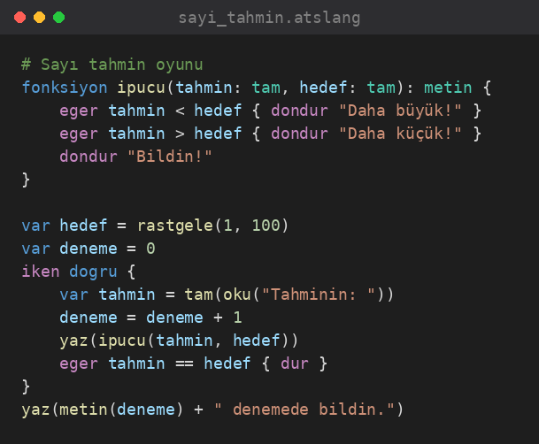

# ATSLang for VS Code

**[ATSLang](https://github.com/DEVEymen/ATSLang)**, Türkçe anahtar kelimeli ve öğrenmesi kolay bir programlama dilidir. Bu eklenti `.atslang` dosyaları için düzenleyici desteği sağlar.



## Özellikler

- 🎨 **Renklendirme:** anahtar kelimeler, metinler ve kaçış dizileri, sayılar, yorumlar, yerleşik fonksiyonlar, tipler
- ⚡ **Otomatik tamamlama:** yazarken bütün anahtar kelimeler ve yerleşik fonksiyonlar Türkçe açıklamalarıyla listelenir
- 🧩 **Kod kalıpları:** `eger` yazıp Enter'a basınca blok kalıbı gelir, `Tab` ile boşluklar arasında geçilir
- 💬 `Ctrl+/` ile satırı yoruma çevirme (`#`)
- 🔗 Parantez, köşeli parantez ve tırnak eşleştirme, `{` sonrasında otomatik girinti

## ATSLang'e kısa bir bakış

```
fonksiyon kare(x: tam): tam {
    dondur x * x
}

her i aralik(1, 5) {
    yaz(metin(i) + " x " + metin(i) + " = " + metin(kare(i)))
}

var ad = oku("Adın ne? ")
eger ad != "" {
    yaz("Merhaba " + ad + "!")
}
```

## Programları çalıştırmak

Bu eklenti yalnızca düzenleyici desteği sağlar. Programları çalıştırmak için ATSLang'in kendisi gerekir:

```
git clone https://github.com/DEVEymen/ATSLang.git
cd ATSLang
pip install -e .
ats program.atslang
```

Ayrıntılar, belgeler ve örnekler: **[github.com/DEVEymen/ATSLang](https://github.com/DEVEymen/ATSLang)**

## Lisans

MIT © 2026 ATS Creative Media
